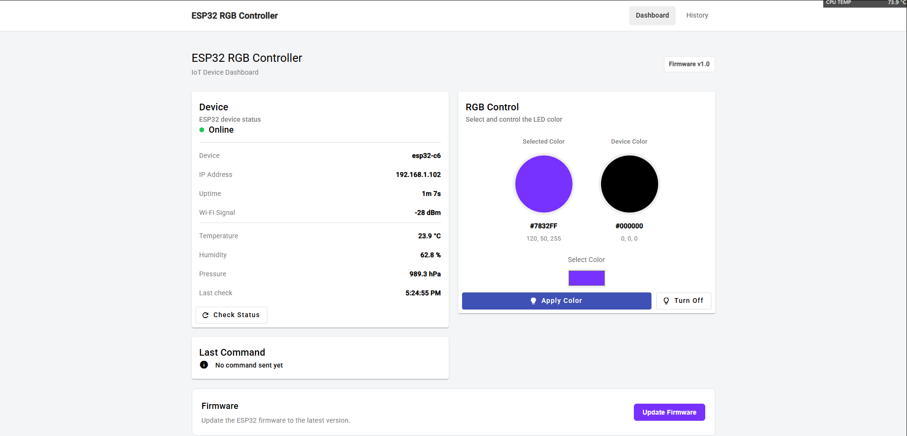
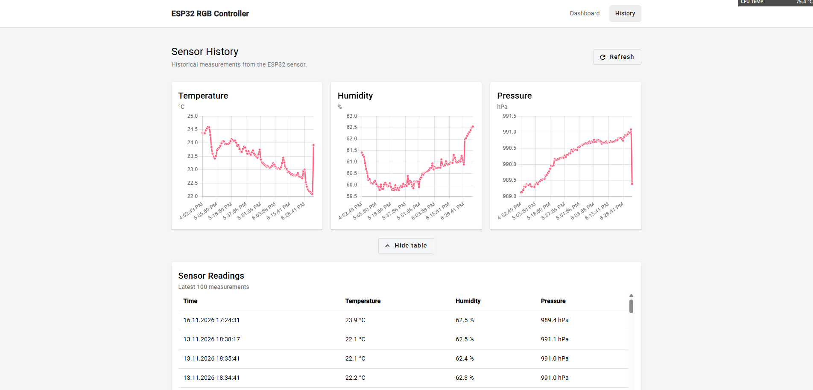

# ESP32 RGB Controller

IoT application for controlling an ESP32-C6 RGB LED and monitoring environmental data from a BME280 sensor.

The project consists of:

- **ESP32-C6** firmware
- **Node.js + Express** backend
- **PostgreSQL** database
- **Angular** frontend

The system supports RGB LED control, real-time device status, temperature/humidity/pressure monitoring, sensor history, and OTA firmware updates.

## Screenshots

### Dashboard


### History

---

## Architecture

```text
Angular Frontend
       │
       ▼
Node.js / Express API
       │
       ├── PostgreSQL
       │
       ▼
   ESP32-C6
       │
       ├── RGB LED
       └── BME280
```

---

## Project Structure

```text
esp32-custom-server/
├── backend/
│   ├── firmware/
│   │   └── firmware.bin
│   ├── routes/
│   ├── services/
│   ├── db.js
│   ├── server.js
│   └── package.json
│
├── frontend/
│
├── esp32-c6-server/
│   ├── esp32-c6-server.ino
│   ├── rgb.h
│   ├── rgb.cpp
│   ├── sensor.h
│   ├── sensor.cpp
│   ├── ota.h
│   ├── ota.cpp
│   └── secrets.h
│
└── README.md
```

---

## Hardware

### ESP32-C6

The project uses a **Waveshare ESP32-C6-DEV-KIT-NX (N16)**.

The board has an integrated addressable RGB LED, so no external RGB LED is required.

```text
RGB LED → GPIO8
```

### BME280

The BME280 is connected using I²C:

```text
BME280    ESP32-C6
------------------
VCC   →   3V3
GND   →   GND
SCL   →   GPIO7
SDA   →   GPIO6
CSB   →   not connected
SDO   →   not connected
```

---

## Requirements

- ESP32-C6 development board
- BME280 sensor
- Arduino IDE
- Node.js
- Angular CLI
- PostgreSQL

---

## 1. ESP32 Firmware

Open:

```text
esp32-c6-server/esp32-c6-server.ino
```

Create `secrets.h` in the same directory:

```cpp
#ifndef SECRETS_H
#define SECRETS_H

#define WIFI_SSID "YOUR_WIFI"
#define WIFI_PASSWORD "YOUR_PASSWORD"

#define FIRMWARE_URL "http://YOUR_PC_IP:3000/api/firmware"

#endif
```

Replace the Wi-Fi credentials and the PC IP address.

The IP address can change depending on your network configuration, so update `FIRMWARE_URL` if the computer running the backend receives a different local IP.

Upload the firmware to the ESP32-C6 using Arduino IDE.

---

## 2. PostgreSQL

Create a database:

```sql
CREATE DATABASE esp32_controller;
```

Create the sensor table:

```sql
CREATE TABLE sensor_readings (
    id SERIAL PRIMARY KEY,
    timestamp TIMESTAMPTZ NOT NULL DEFAULT NOW(),
    temperature DOUBLE PRECISION NOT NULL,
    humidity DOUBLE PRECISION NOT NULL,
    pressure DOUBLE PRECISION NOT NULL
);
```

---

## 3. Backend

Navigate to:

```text
backend/
```

Install dependencies:

```bash
npm install
```

Create `.env`:

```env
PORT=3000
ESP32_URL=http://ESP32_IP
DB_HOST=localhost
DB_PORT=5432
DB_NAME=esp32_controller
DB_USER=postgres
DB_PASSWORD=YOUR_PASSWORD
```

Replace `ESP32_IP` with the current IP address of the ESP32.

The ESP32 IP can change if your router uses DHCP.

Start the backend:

```bash
node server.js
```

The API will be available at:

```text
http://localhost:3000
```

---

## 4. Frontend

Navigate to:

```text
frontend/
```

Install dependencies:

```bash
npm install
```

Start Angular:

```bash
ng serve
```

Open:

```text
http://localhost:4200
```

---

## API

| Method | Endpoint | Description |
|---|---|---|
| `POST` | `/api/color` | Set RGB color |
| `GET` | `/api/status` | Get device status |
| `GET` | `/api/history` | Get sensor history |
| `GET` | `/api/firmware` | Download firmware |
| `POST` | `/api/update` | Start OTA update |

---

## OTA Firmware Updates

Firmware updates are performed through the backend:

```text
Angular
   ↓
POST /api/update
   ↓
Node.js Backend
   ↓
POST /api/update
   ↓
ESP32
   ↓
Downloads firmware from
/api/firmware
   ↓
Installs update
   ↓
Restarts
```

The current firmware version is displayed on the dashboard.

To release a new firmware version:

1. Change `FIRMWARE_VERSION` in the ESP32 firmware.
2. Compile the firmware.
3. Place the generated `.bin` file in:

```text
backend/firmware/firmware.bin
```

4. Start the backend.
5. Use **Update Firmware** from the dashboard.

---

## Running the Full System

Start the following components:

### PostgreSQL

Make sure the database is running.

### Backend

```bash
cd backend
node server.js
```

### Angular

```bash
cd frontend
ng serve
```

### ESP32

Power the ESP32 and make sure it is connected to the configured Wi-Fi network.

Then open:

```text
http://localhost:4200
```

The dashboard can be used to control the RGB LED, view the current device status, monitor sensor data, view historical measurements, and update the firmware.